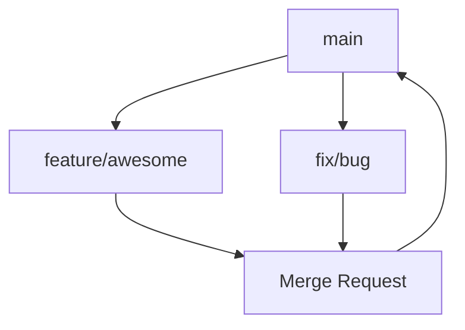

# 🤝 Contributing to FYGS.dev

> Building the future of personal portfolio websites together! 🚀

[](https://conventionalcommits.org)
[](CODE_OF_CONDUCT.md)
[](https://makeapullrequest.com)

## 🎯 Quick Links

- 📚 [Documentation](docs/README.md)
- 🐛 [Issue Tracker](https://gitlab.com/fygs/fygs.dev/-/issues)
- 💬 [Discussions](https://gitlab.com/fygs/fygs.dev/-/discussions)
- 📋 [Project Board](https://gitlab.com/fygs/fygs.dev/-/boards)
- 📊 [CI/CD Pipeline](https://gitlab.com/fygs/fygs.dev/-/pipelines)

## 🌟 Ways to Contribute

- 📝 Improve documentation
- 🐛 Report bugs
- 💡 Suggest new features
- 🔍 Review code
- 🎨 Enhance UI/UX
- ⚡ Optimize performance
- 🌐 Add translations
- ✅ Write tests

## 🚀 Development Workflow

### Prerequisites

- Node.js >= 18
- pnpm >= 8
- Git >= 2.37

### 🔧 Setup

```bash
# Clone your fork
git clone git@gitlab.com:${YOUR_USERNAME}/fygs.dev.git

# Add upstream remote
git remote add upstream git@gitlab.com:fygs/fygs.dev.git

# Install dependencies
pnpm install

# Setup environment
pnpm setup

# Start development
pnpm dev
```

### 🌿 Branch Strategy



#### Branch Types
- `feature/*` - New features
- `fix/*` - Bug fixes
- `docs/*` - Documentation
- `perf/*` - Performance
- `refactor/*` - Code refactoring
- `test/*` - Testing
- `chore/*` - Maintenance

### 💻 Development Process

1. 🔄 Sync with upstream
```bash
git checkout main
git fetch upstream
git rebase upstream/main
```

2. 🌿 Create feature branch
```bash
git checkout -b feature/amazing-feature
```

3. 🚧 Make changes
```bash
git add .
git commit -m "feat: add amazing feature"
```

4. 🧪 Test your changes
```bash
# Run tests
pnpm test

# Check types
pnpm type-check

# Lint code
pnpm lint

# Check formatting
pnpm format:check
```

5. 📤 Push changes
```bash
git push origin feature/amazing-feature
```

### ✅ Local checks

```bash
pnpm lint                 # also generates the intlayer dictionaries
pnpm tsc --noEmit         # needs those dictionaries: run `pnpm intlayer build` first on a fresh checkout,
                          # otherwise it reports TS7006 (implicit any) on every translated component
pnpm test                 # unit tests
```

On Windows, `.gitattributes` keeps `public/sandbox/**` byte for byte (the previews are pinned by hash) and snapshots in LF.
After changing these rules, re-extract the files (`git rm --cached` is not needed: delete them and `git checkout -- <path>`).

### 📝 Commit Convention

We use [Conventional Commits](https://www.conventionalcommits.org/):

\`\`\`
<type>(<scope>): <description>

[optional body]

[optional footer(s)]
\`\`\`

#### Types
- `feat` - Features
- `fix` - Bug Fixes
- `docs` - Documentation
- `style` - Styling
- `refactor` - Code Refactoring
- `perf` - Performance
- `test` - Testing
- `chore` - Maintenance

#### Examples
```bash
feat(projects): add filtering by technology
fix(auth): resolve token expiration issue
docs(api): update authentication docs
style(ui): improve dark mode contrast
```

### 🔍 Code Review Process

1. 📋 Fill MR template completely
2. 🏷️ Add appropriate labels
3. 🔗 Link related issues
4. 👥 Request reviews
5. 📢 Respond to feedback
6. ✅ Update based on reviews
7. 🎯 Ensure CI passes

### ⚡ Performance Guidelines

- Optimize images
- Lazy load components
- Minimize bundle size
- Use proper caching
- Implement code splitting
- Profile rendering performance

### 🧪 Testing Requirements

- Unit tests for utilities
- Integration tests for features
- E2E tests for critical paths
- Performance benchmarks
- Accessibility tests
- Browser compatibility tests

## 📦 Release Process

1. Update CHANGELOG.md
2. Bump version
```bash
pnpm version <major|minor|patch>
```
3. Create release MR
4. Deploy to staging
5. Verify deployment
6. Deploy to production

## 🏆 Recognition

Contributors get:
- 📝 Credit in CHANGELOG
- 🎯 Recognition in releases
- 💫 Special mentions
- 🌟 Contributor badges

## 📬 Support & Questions

- 📮 [Open an issue](https://gitlab.com/fygs/fygs.dev/-/issues/new)
- 💬 [Start a discussion](https://gitlab.com/fygs/fygs.dev/-/discussions)
- 📧 Email: contact@fygs.dev

---

<div align="center">

🙏 Thank you for contributing to FYGS.dev!

[](https://gitlab.com/fygs/fygs.dev)

</div>
