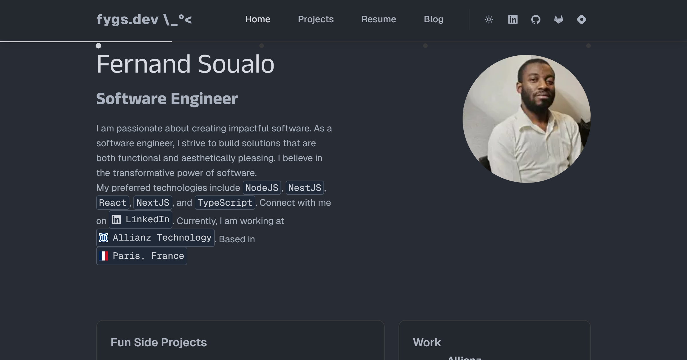

<div align="center">
  

# FYGS.dev - Modern Learning Platform & Portfolio

[](https://nextjs.org/)
[](https://reactjs.org/)
[](https://www.typescriptlang.org/)
[](https://better-auth.com)
[](https://prisma.io)
[](https://tailwindcss.com)
[](https://redis.io)
[](https://stripe.com)
[](https://fygs.dev)
[](package.json)
[](LICENSE)

  <h3>
    <a href="https://www.fygs.dev">Website</a>
    <span> · </span>
    <a href="https://www.fygs.dev/blog">Blog</a>
    <span> · </span>
    <a href="https://www.fygs.dev/projects">Projects</a>
    <span> · </span>
    <a href="https://www.fygs.dev/resume">Contact</a>
  </h3>

  
</div>

## 🌟 Overview

A modern learning platform combining professional portfolio with interactive courses. Built with Next.js 15, Better Auth, and Prisma for scalable education technology.

### ✨ Key Features

**Frontend**
- 🚀 **Performance**: 100/100 Lighthouse score with Next.js 15.5.3 optimizations
- 🎨 **Design**: Modern UI with dark mode and responsive design (shadcn/ui v0.7.1)
- 🔒 **Authentication**: Better Auth v1.3.11 with social providers (Google, GitHub, Apple)
- 📱 **Mobile-First**: Optimized for all devices with React 19.1.1

**Learning Management**
- 📚 **Course Catalog**: Free and premium courses with tier-based access
- 🎯 **Progress Tracking**: Lesson completion with Redis-powered watch time analytics
- 🎓 **Certificates**: Auto-issued upon 100% course completion (jsPDF v2.5.2)
- 💡 **Course Preview**: First lesson access for unenrolled users

**Subscription & Billing**
- 💳 **Stripe Integration**: v18.5.0 - Monthly/yearly subscriptions with plan switching
- 🔄 **Refund Policy**: 15-day eligibility window with automated calculation
- 💰 **Lifetime Access**: Purchased courses retained after subscription cancellation
- 📊 **Audit Trail**: Complete transaction and proration history

**Analytics & Monitoring**
- 📈 **Event Tracking**: PII-safe analytics with correlation IDs (Vercel Analytics v1.5.0)
- 🔍 **Structured Logging**: Context-aware logging for debugging
- 🎯 **Business Intelligence**: Enrollment, completion, and revenue metrics
- 🚨 **Error Monitoring**: Comprehensive error tracking and alerting

### 🏗️ Architecture

**Frontend Stack**
- **Framework**: Next.js 15.5.3 with App Router and React Server Components 19.1.1
- **Styling**: Tailwind CSS 3.4.17 with shadcn/ui components
- **State Management**: Zustand 5.0.3 for client state, nuqs 2.4.1 for URL state
- **Forms**: React Hook Form 7.55.0 with Zod 3.24.2 validation
- **Animations**: Framer Motion 11.18.2 for smooth interactions

**Backend Infrastructure** 
- **Database**: PostgreSQL with Prisma ORM 6.16.3
- **Cache**: Native Redis client with ioredis 5.8.1 (replaced Upstash)
- **Authentication**: Better Auth 1.3.11 with JWT sessions
- **API**: Server Actions (replacing traditional API routes)
- **Email**: Transactional emails with Nodemailer 7.0.6
- **Payments**: Stripe 18.5.0 for subscription management

**DevOps & Infrastructure**
- **Hosting**: Vercel with Edge Runtime support
- **Database**: Hosted PostgreSQL (Railway/Supabase)
- **CDN**: Vercel Edge Network
- **CI/CD**: GitHub Actions with Coolify deployment
- **Monitoring**: Structured logging + Vercel Analytics 1.5.0
- **Security**: CodeQL analysis, dependency review

## 🖼️ Preview

<div align="center">
  
  <sub><i>Generated preview image showcasing the website's responsive design</i></sub>
</div>

## 🛠️ Tech Stack

<details>
<summary>Click to expand complete dependency list</summary>

### Core Framework
- **Next.js**: 15.5.3 - React framework with App Router
- **React**: 19.1.1 - User interface library
- **TypeScript**: 5.8.2 - Type-safe JavaScript

### Authentication & Security  
- **Better Auth**: 1.3.11 - Modern authentication solution
- **Zod**: 3.24.2 - Schema validation

### Database & Caching
- **Prisma**: 6.16.3 - Type-safe database ORM
- **ioredis**: 5.8.1 - Native Redis client (replaced Upstash)

### UI & Styling
- **TailwindCSS**: 3.4.17 - Utility-first CSS framework
- **Radix UI**: Latest - Accessible component primitives
- **shadcn/ui**: Latest - Pre-built component system
- **Framer Motion**: 11.18.2 - Production-ready motion library
- **Lucide React**: 0.453.0 - Beautiful icons
- **next-themes**: 0.4.6 - Theme switching

### State Management
- **Zustand**: 5.0.3 - Lightweight state management
- **nuqs**: 2.4.1 - Type-safe URL state management

### Forms & Validation
- **React Hook Form**: 7.55.0 - Performant forms
- **@hookform/resolvers**: 3.10.0 - Schema resolvers

### Payments & Analytics
- **Stripe**: 18.5.0 - Payment processing
- **@stripe/stripe-js**: 2.4.0 - Stripe JavaScript SDK
- **Vercel Analytics**: 1.5.0 - Web analytics
- **Vercel Speed Insights**: 1.2.0 - Performance monitoring

### Content & Rich Text
- **@mdx-js/react**: 3.1.0 - MDX support
- **next-mdx-remote**: 5.0.0 - Remote MDX loading
- **gray-matter**: 4.0.3 - Front matter parsing
- **remark-gfm**: 4.0.1 - GitHub Flavored Markdown
- **rehype-highlight**: 7.0.2 - Syntax highlighting
- **react-syntax-highlighter**: 15.6.1 - Code highlighting

### Development Tools
- **Monaco Editor**: 0.52.2 - VS Code editor experience
- **@monaco-editor/react**: 4.7.0 - React wrapper for Monaco
- **Puppeteer**: 22.15.0 - Browser automation for testing

### Data Visualization
- **Recharts**: 2.15.2 - Composable charting library
- **D3**: 7.9.0 - Data-driven visualizations
- **Three.js**: 0.176.0 - 3D graphics library

### Utilities
- **date-fns**: 4.1.0 - Date utility library  
- **clsx**: 2.1.1 - Conditional class names
- **class-variance-authority**: 0.7.1 - CVA for component variants
- **tailwind-merge**: 2.6.0 - Tailwind class merging
- **fuse.js**: 7.1.0 - Fuzzy search
- **natural**: 8.0.1 - Natural language processing
- **jspdf**: 2.5.2 - PDF generation
- **canvas-confetti**: 1.9.3 - Confetti animations

### Development Dependencies
- **ESLint**: 8.57.1 - Code linting
- **Prettier**: Auto-formatting (via ESLint config)
- **Vitest**: 2.1.9 - Fast unit testing
- **TypeScript**: 5.8.2 - Type checking
- **Sharp**: 0.33.5 - Image optimization
- **dotenv-cli**: 10.0.0 - Environment variable management

</details>

- **Package Manager**: [pnpm](https://pnpm.io/)
- **Linting**: [ESLint](https://eslint.org/) + [Prettier](https://prettier.io/)
- **Git Hooks**: [Husky](https://typicode.github.io/husky/) + [lint-staged](https://github.com/okonet/lint-staged)
- **Testing**: [Vitest](https://vitest.dev/) + (Planned) component & e2e harness

### Infrastructure

- **Deployment**: [Vercel](https://vercel.com)
- **Analytics**: [Vercel Analytics](https://vercel.com/analytics)
- **Monitoring**: [Sentry](https://sentry.io)
- **CI/CD**: [GitLab CI/CD](https://docs.gitlab.com/ee/ci/)

</details>

## 📊 Performance Metrics

<details>
<summary>Click to expand</summary>

### 📈 Lighthouse Scores

- **Performance**: 100/100
- **Accessibility**: 100/100
- **Best Practices**: 100/100
- **SEO**: 100/100

### ⚡ Core Web Vitals

- **LCP**: < 1.5s
- **FID**: < 100ms
- **CLS**: < 0.1

### 🔧 Optimizations

- Code splitting & lazy loading
- Automatic image optimization
- Font subsetting & optimization
- CSS purging & minification
- Tree shaking & dead code elimination
- Edge caching & CDN distribution

</details>

## 🚀 Quick Start

```bash
# Clone repository
git clone https://gitlab.com/fygs/fygs.dev.git
cd fygs.dev

# Install dependencies
pnpm install

# Set up environment variables
cp .env.example .env.local

# Start development server
pnpm dev
```

## 🧪 Testing

```bash
# Run unit tests (Vitest)
pnpm test

# Watch mode
pnpm test:watch
```

## 📦 Deployment

## 🔁 API Hardening

- Stripe manage endpoint now requires an `idempotencyKey` field for state-changing actions (switch_plan, cancel_*, refund_course).
- Rate limiting: 10 management actions per user per 5 minutes (429 RATE_LIMITED response with reset timestamp).
- Analytics events expanded: SUBSCRIPTION_PAYMENT_FAILED plus prior lifecycle events.

The project is automatically deployed to Vercel through GitLab CI/CD pipelines.

### Manual Deployment

```bash
# Build for production
pnpm build

# Start production server
pnpm start
```

## 📝 Documentation

<details>
<summary>Click to expand</summary>

### 📚 Architecture

- [Architecture Overview](docs/ARCHITECTURE.md)
- [Component Structure](docs/COMPONENTS.md)
- [State Management](docs/STATE.md)
- [API Documentation](docs/API.md)

### 🔧 Development Guides

- [Contributing Guidelines](CONTRIBUTING.md)
- [Code Style Guide](docs/CODE_STYLE.md)
- [Testing Strategy](docs/TESTING.md)
- [Performance Optimization](docs/PERFORMANCE.md)

### 📋 Project Management

- [Project Roadmap](docs/ROADMAP.md)
- [Release Process](docs/RELEASES.md)
- [Security Policy](SECURITY.md)

</details>

## 🔐 Security

See [SECURITY.md](SECURITY.md) for reporting vulnerabilities and our security policy.

## 📄 License

This project is licensed under the MIT License - see the [LICENSE](LICENSE) file for details.

## 🤝 Contributing

Contributions are welcome! Please read our [Contributing Guidelines](CONTRIBUTING.md) first.

1. Fork the repository
2. Create your feature branch (`git checkout -b feature/AmazingFeature`)
3. Commit your changes (`git commit -m 'Add some AmazingFeature'`)
4. Push to the branch (`git push origin feature/AmazingFeature`)
5. Open a Merge Request

## 📬 Contact

Fernand SOUALO - [@fygs](https://twitter.com/fygs) - contact@fygs.dev

Project Link: [https://gitlab.com/fygs/fygs.dev](https://gitlab.com/fygs/fygs.dev)

## 🚀 FYGS.dev - Portfolio & Technical Interview Platform

Un portfolio moderne et une plateforme de préparation aux entretiens techniques, construit avec Next.js 14, TypeScript, et TailwindCSS.

## ✨ Fonctionnalités

### 🎯 Plateforme d'Entretiens Techniques

- **Défis de Codage Interactifs**
  - Exercices de manipulation de chaînes
  - Défis sur les tableaux
  - Chronomètre intégré de 5 minutes
  - Solutions détaillées et indices
  - Validation en temps réel

### 🎨 Design & UX

- **Interface Moderne**
  - Design responsive et adaptatif
  - Thème clair/sombre automatique
  - Animations fluides avec Framer Motion
  - Loader automatique lors des transitions
  - Composants UI personnalisés avec shadcn/ui

### 🛡️ Gestion des Erreurs & Maintenance

- **Pages d'Erreur Personnalisées**
  - Page 404 animée
  - Page d'erreur globale
  - Page d'accès non autorisé
  - Mode maintenance configurable

### 🔧 Caractéristiques Techniques

- **Performance**
  - Rendu côté serveur (SSR)
  - Optimisation des images
  - Transitions de page fluides
  - Chargement progressif

## 🛠️ Technologies

- **Framework**: Next.js 14
- **Language**: TypeScript
- **Styling**: TailwindCSS
- **UI Components**: shadcn/ui
- **Animations**: Framer Motion
- **State Management**: Zustand
- **Icons**: Lucide React

## 📦 Installation

1. Cloner le repository :

```bash
git clone https://github.com/fygs/fygs.dev.git
```

2. Installer les dépendances :

```bash
npm install
# ou
yarn install
```

3. Configurer les variables d'environnement :

```bash
cp .env.example .env.local
```

4. Lancer le serveur de développement :

```bash
npm run dev
# ou
yarn dev
```

## 🔐 Configuration

### Variables d'Environnement

- `NODE_ENV`: Environnement (development/production)
- `ADMIN_API_KEY`: Clé API pour le mode maintenance
- `NEXT_PUBLIC_*`: Variables publiques diverses

### Mode Maintenance

Le mode maintenance peut être activé via :

- Configuration dans `config/maintenance.ts`
- API REST sécurisée (`/api/maintenance`)
- Variables d'environnement

## 📚 Documentation

- [Guide de Contribution](./CONTRIBUTING.md)
- [Journal des Modifications](./CHANGELOG.md)
- [Guide de Style](./STYLE_GUIDE.md)

## 🤝 Contribution

Les contributions sont les bienvenues ! Consultez notre [Guide de Contribution](./CONTRIBUTING.md) pour plus d'informations.

## 📝 Licence

Ce projet est sous licence MIT - voir le fichier [LICENSE](./LICENSE) pour plus de détails.

## 📧 Contact

- LinkedIn: [Fernand Soualo](https://www.linkedin.com/in/fernandsoualo/)
- GitHub: [@fygs](https://github.com/fygs)
- Hashnode: [@FYGS](https://hashnode.com/@FYGS)
- Email: fygs.dev@gmail.com

https://code.visualstudio.com/docs/copilot/copilot-customization#_reusable-prompt-files-experimental

Comptes vercel:

- ouestech@contact.com => anumerique / annonce NCR
- fernandsoualo@gmail.com => fygs.dev / school mgt system
